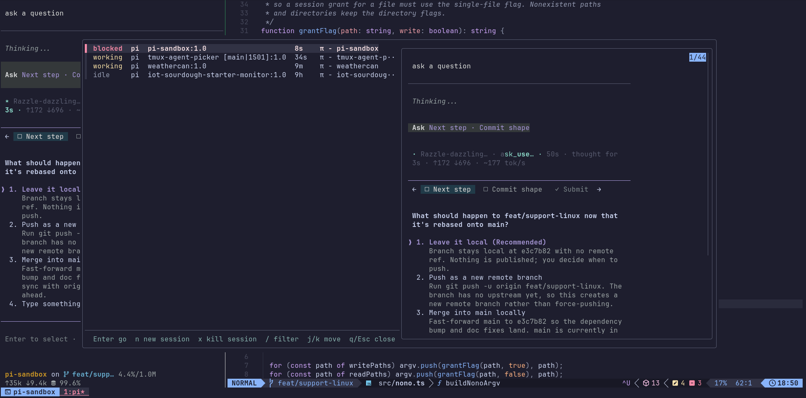

# tmux agent picker

Yet another agent picker, but this one is simple and mine, and does just what I need it to do. Written in bash in just a few hundred lines of code.



Press `prefix + a` for a list of agent panes sorted by who needs you first: blocked agents at the top, then working, done, and idle. `Enter` jumps to the pane. `n` opens a zoxide-backed directory picker to switch to or create a session without leaving the popup.

- **See what needs attention** — state, agent, session, and age in one line per agent.
- **Jump straight to the work** — selecting a row switches your client to that pane and window.
- **Filter or clean up** — `/` filters, `x` kills the session under the cursor.
- **Any agent** — pi reports state out of the box; any agent can report with a single command.

## Requirements

- tmux with `display-popup` support
- [fzf](https://github.com/junegunn/fzf)
- [zoxide](https://github.com/ajeetdsouza/zoxide) for the `n` directory picker
- pi for the built-in lifecycle reporting (optional; any agent can report state)

## Install

Install [TPM](https://github.com/tmux-plugins/tpm), then add the plugin above TPM's bootstrap line in `~/.tmux.conf`:

```tmux
set -g @plugin 'justinmklam/tmux-agent-picker'
run '~/.tmux/plugins/tpm/tpm'
```

Reload tmux and press `prefix + I`:

```sh
tmux source-file ~/.tmux.conf
```

TPM does not install the pi extension, so link it separately:

```sh
plugin_dir=$(tmux show-environment -g TMUX_PLUGIN_MANAGER_PATH | cut -d= -f2-)
ln -s "$plugin_dir/tmux-agent-picker/pi/agent-state.ts" ~/.pi/agent/extensions/agent-state.ts
```

Run `/reload` in pi, then press `prefix + a`.

> TPM normally installs to `~/.tmux/plugins/tmux-agent-picker`. If `TMUX_PLUGIN_MANAGER_PATH` points elsewhere, use that directory instead. For a non-TPM checkout, see [Direct checkout installation](docs/DEVELOPMENT.md#direct-checkout-installation).

## Usage

| Key | Action |
| --- | --- |
| `Enter` | Go to the selected agent or session |
| `j` / `k` | Move down / up |
| `n` | Open the directory picker, then switch to or create that session |
| `x` | Kill the session under the cursor; confirms with `y`/`Y` |
| `/` | Filter mode; `n` and `x` type normally there |
| `q` / `Esc` | Close; `Esc` first clears the query and leaves filter mode |

### Agent states

| State | Meaning |
| --- | --- |
| `blocked` | Waiting for your permission, answer, or other input |
| `working` | Actively handling a prompt |
| `done` | Finished a turn and needs your attention |
| `idle` | Not running, or a finished agent you already looked at |

Rows are grouped `blocked`, `working`, `done`, `idle`, then newest first within each group. Looking at a pane turns its `done` state into `idle` automatically, so finished agents keep their place in the list. Sessions without an agent pane appear at the bottom as `session <name>`.

## Uninstall

Remove the `@plugin` line from `~/.tmux.conf`, then clear the binding and hooks before reloading:

```sh
tmux unbind-key -T prefix a
tmux set-hook -gu 'pane-focus-in[77]'
tmux set-hook -gu 'after-select-pane[77]'
tmux set-hook -gu 'after-select-window[77]'
tmux set-hook -gu 'client-session-changed[77]'
tmux set-environment -gu TMUX_AGENT_PICKER_ROOT
tmux source-file ~/.tmux.conf
rm ~/.pi/agent/extensions/agent-state.ts
```

Run `/reload` in pi. Press `prefix + alt + u` in tmux to let TPM remove the plugin directory, or delete it under `$TMUX_PLUGIN_MANAGER_PATH` yourself. Restarting the tmux server also clears the binding, hooks, theme options, and `focus-events`.

## Development

See [docs/DEVELOPMENT.md](docs/DEVELOPMENT.md) for architecture, state reporting, themes, and development workflows, and [docs/AGENT_SUPPORT.md](docs/AGENT_SUPPORT.md) for adding support for other agents.
